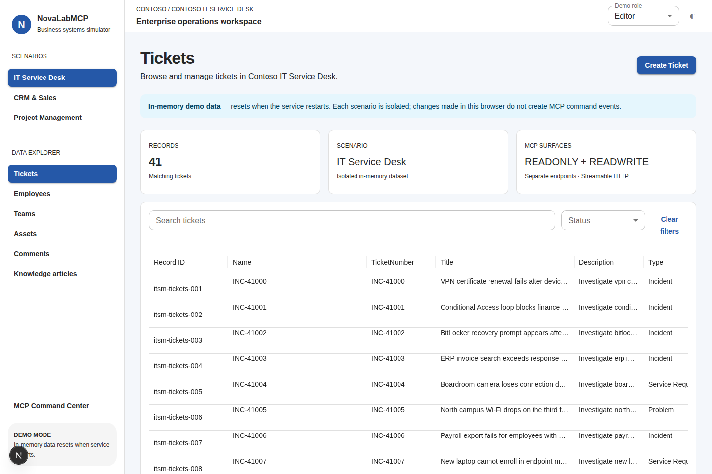

# NovaLabMCP

NovaLabMCP is an in-memory enterprise systems simulator demonstrating isolated
IT Service Desk, CRM & Sales, and Project Management scenarios through a .NET
10 REST API and separate read-only/read-write MCP Streamable HTTP endpoints.
The Next.js application provides a scenario data explorer and a live MCP
Command Center.



> **Demo data only:** data and MCP activity are held in process memory and reset
> when the API restarts. Do not use real customer data or treat the service as a
> production business system.

## Prerequisites

- .NET 10 SDK
- Node.js 24 and npm

## Run locally

Start the API (development settings enable local demo authentication):

```bash
dotnet restore NovaLabMCP.sln
dotnet run --project src/NovaLabMCP.Api
```

The launch profile listens on `http://localhost:5290`. In another terminal:

```bash
cd src/novalabmcp-web
npm ci
NEXT_PUBLIC_API_URL=http://localhost:5290 npm run dev
```

Open <http://localhost:3000>. The role selector is a local-only demo control;
the API accepts `X-Demo-Role: DemoViewer`, `DemoEditor`, or `DemoAdmin` only in
Development. Demo authentication is rejected outside Development. Production
mode requires `NOVALABMCP_AUTHORITY` and `NOVALABMCP_AUDIENCE` and validates
Entra-issued bearer tokens.

Useful checks:

```bash
dotnet build NovaLabMCP.sln
dotnet test NovaLabMCP.sln
cd src/novalabmcp-web
npm run lint
npm run typecheck
npm run build
npm audit
```

## REST and MCP

- REST base path: `/api/v1/{itsm|crm|projects}/{entity}`
- OpenAPI: `/openapi/v1.json`
- Health: `/health/live` and `/health/ready`
- MCP tools: `/mcp/{readonly|readwrite}/{itsm|crm|projects}`
- MCP activity: `/api/v1/mcp-activity` and `/api/v1/mcp-activity/stream`

Each MCP path has an independent tool catalog. For example, a local MCP client
can connect to the IT Service Desk read-only endpoint:

```json
{
  "servers": {
    "novalabmcp-itsm-readonly": {
      "type": "http",
      "url": "http://localhost:5290/mcp/readonly/itsm"
    }
  }
}
```

Use `/mcp/readwrite/itsm`, `/mcp/readonly/crm`,
`/mcp/readwrite/crm`, `/mcp/readonly/projects`, or
`/mcp/readwrite/projects` for other capabilities. In local development, set
`X-Demo-Role: DemoEditor` in the MCP client's HTTP headers to exercise write
tools. Never send demo-role headers to production; deployed requests use
bearer-token authentication and server-side role claims.

Example read-only MCP tool call:

```bash
curl -sS http://localhost:5290/mcp/readonly/itsm \
  -H 'Content-Type: application/json' \
  -H 'Accept: application/json, text/event-stream' \
  -d '{"jsonrpc":"2.0","id":1,"method":"tools/call","params":{"name":"readonly_itsm_list_tickets","arguments":{"page":1,"pageSize":10}}}'
```

Activity is redacted, bounded, and ephemeral. REST/UI mutations are not reported
as MCP commands.

## Repository map

- `src/NovaLabMCP.Api` — REST API, in-memory scenario store, MCP tools, and
  activity streaming.
- `src/novalabmcp-web` — Next.js/TypeScript/MUI frontend.
- `tests/NovaLabMCP.Tests` — domain store and MCP capability tests.
- `docs` — architecture, MCP usage, deployment, and UI screenshot.
- `NovaLabMCP-implementation-spec.md` — full implementation requirements.

## Deployment

Azure Container Apps infrastructure and GitHub Actions use OIDC federation;
the workflow intentionally does not use a long-lived `AZURE_CREDENTIALS`
secret. See [deployment instructions](docs/deployment.md) for the required
Azure/GitHub configuration and deployment limitations.
